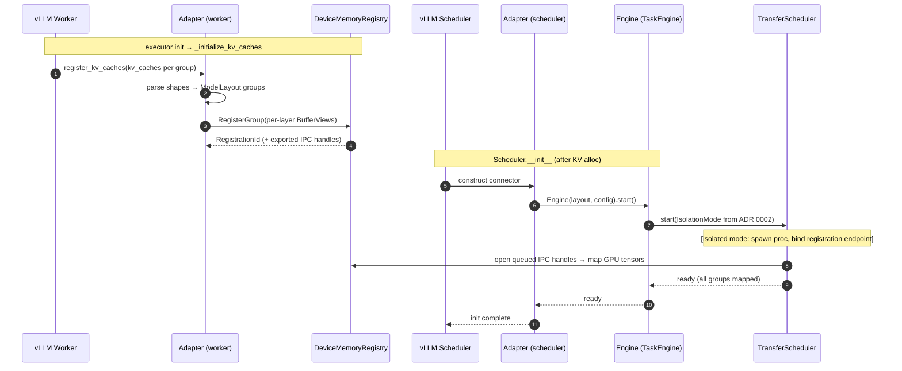
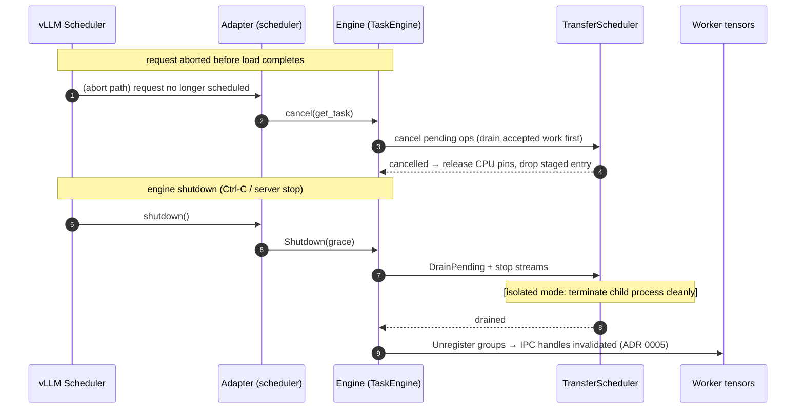

# StrataKV — Class APIs and Sequence Diagrams

Companion to `roadmap.md`. Concrete API surface introduced by each phase,
followed by sequence diagrams of the final architecture. All names are
provisional until gate G1; signatures follow the mandated style (C++20,
Google style, Doxygen `/// \brief` on public APIs — abbreviated here to
one-liners, full parameter/return docs land with implementation per Phase
B standards). Thread-safety and ownership annotations are normative.

Conventions:
- `std::span<const T>` = borrowed, caller-owned, must outlive the call (or task, where stated).
- `std::unique_ptr` / `std::shared_ptr` = ownership transferred/shared as marked.
- All blocking entry points at the Python boundary release the GIL (ADR 0004).
- Handles are trivially copyable value types; validity is checked lazily.

---

## Phase B — Core object model (`stratakv::common`)

Target: `include/stratakv/common/types.h`, `model_layout.h`, `handles.h`.

```cpp
namespace stratakv::common {

using TokenId = std::int64_t;
using BlockId = std::uint32_t;

/// \brief Kind of memory a BufferView points into.
enum class DeviceKind : std::uint8_t { kGpu, kCpuPinned, kCpu, kSsd };

/// \brief Non-owning view of one contiguous memory region.
/// Thread safety: immutable after construction; safe to copy across threads.
struct BufferView {
  void* base = nullptr;        ///< Raw pointer; never owned by StrataKV.
  DeviceKind kind{};           ///< Where the memory lives.
  int device_id = -1;          ///< CUDA device (kGpu) or NUMA node hint.
  std::uint64_t size_bytes = 0;
  std::vector<std::uint64_t> strides_bytes;  ///< Row-major strides per dim.
};

// ---- Layer specification (heterogeneous from day one; ADR 0003) ----

/// \brief Full-attention KV geometry (paged token blocks).
struct FullAttnSpec {
  int num_kv_heads = 0;
  int head_size = 0;
};

/// \brief Multi-head latent attention (absorbed, single latent tensor).
struct MlaSpec {
  int kv_lora_rank = 0;
  int rope_dim = 0;
};

/// \brief Sliding-window attention KV (window-bounded storage).
struct SlidingWindowSpec {
  int num_kv_heads = 0;
  int head_size = 0;
  int window_blocks = 0;       ///< Reuse horizon in blocks.
};

/// \brief Linear-attention / SSM recurrent state (not token-addressable).
struct LinearStateSpec {
  std::uint64_t state_bytes = 0;  ///< Fixed-size state tensor per layer.
};

/// \brief Variant over all supported per-group KV geometries.
using LayerSpec = std::variant<FullAttnSpec, MlaSpec,
                               SlidingWindowSpec, LinearStateSpec>;

/// \brief A group of layers sharing one spec and one storage pool.
struct LayerGroup {
  std::string name;            ///< e.g. "full_attn", "linear_state".
  LayerSpec spec;
  std::vector<int> layer_indices;
  int tokens_per_block = 16;   ///< 0 for LinearStateSpec groups.
};

/// \brief Heterogeneous model description; the root of all layout math.
/// Thread safety: immutable after FromGroups; share freely.
class ModelLayout {
 public:
  static ModelLayout FromGroups(std::vector<LayerGroup> groups);
  const LayerGroup& Group(size_t index) const;
  size_t num_groups() const;
  /// \brief True iff every group is FullAttn/Mla (classic cacheable model).
  bool IsHomogeneousKV() const;
};

// ---- References and cache entries ----

/// \brief Stable identifier of a storage tier instance.
using TierId = std::uint32_t;

/// \brief Reference to one token-block slot inside a tier's pool.
struct BlockRef {
  TierId tier = 0;
  BlockId block = 0;
  std::uint32_t refcount = 0;  ///< Pins against eviction while > 0.
};

/// \brief Reference to one fixed-size state object (sidecar) in a tier.
struct StateRef {
  TierId tier = 0;
  std::uint32_t object = 0;
  std::uint32_t refcount = 0;
};

/// \brief Everything needed to resume a prefix at one boundary.
/// A match is usable only when is_ready and every ref resolves (ADR 0003:
/// no partial caching — all groups present or the entry does not count).
struct CacheEntry {
  std::vector<BlockRef> blocks;   ///< Token blocks, prefix order, per group.
  std::vector<StateRef> states;   ///< Sidecar states at this boundary.
  bool is_ready = false;          ///< Data landed in tier (vs. reserved).
};

// ---- Task handles ----

/// \brief Opaque, copyable handle to a submitted task.
class TaskHandle {
 public:
  std::uint64_t id() const;
  bool IsValid() const;
};

/// \brief Task lifecycle states (control plane state machine).
enum class TaskState {
  kStaged, kLaunched, kSucceeded, kFailed, kCancelled
};

}  // namespace stratakv::common
```

---

## Phase C — Metadata plane (`stratakv::metadata`)

Target: `include/stratakv/metadata/`. Harvests: `csrc/radix_tree.cpp`,
`csrc/hash.cpp` (chained xxHash), `Mempool` free-list semantics.

```cpp
namespace stratakv::metadata {

/// \brief Result of a prefix match against the index.
struct MatchResult {
  std::uint32_t matched_blocks = 0;      ///< Longest ready prefix, blocks.
  std::uint32_t matched_blocks_reserved = 0;  ///< Present but not ready.
  std::vector<common::BlockRef> block_refs;  ///< For matched_blocks, per group.
  std::vector<common::StateRef> state_refs;
  /// \brief Token-level mask (true = externally servable), caller-sized.
  std::vector<std::uint8_t> token_mask;
};

/// \brief Options controlling readiness filtering and locking.
struct MatchOptions {
  bool lock_matched = true;     ///< Increment refcounts (pin vs eviction).
  bool require_ready = true;    ///< ADR 0003: only complete, landed bundles.
};

/// \brief Interface over the prefix index (port of FlexKV radix tree).
/// Thread safety: implementations must serialize or shard internally;
/// all methods are safe to call from any engine thread.
class IIndex {
 public:
  virtual ~IIndex() = default;

  /// \brief Longest-prefix match with readiness filtering. Never blocks
  /// on I/O; pure metadata lookup.
  virtual MatchResult Match(std::span<const common::TokenId> tokens,
                            std::uint32_t tokens_per_block,
                            const MatchOptions& opts) = 0;

  /// \brief Insert (or extend) an entry for the block-aligned prefix.
  /// Returns the entry; data marked not-ready until CommitReady.
  virtual common::CacheEntry* Insert(std::span<const common::TokenId> tokens,
                                     std::vector<common::BlockRef> blocks,
                                     std::vector<common::StateRef> states) = 0;

  /// \brief Flip an entry to ready after its transfer completed.
  virtual void CommitReady(common::CacheEntry* entry) = 0;

  /// \brief Drop refcounts acquired by a Match(lock_matched=true).
  virtual void Release(const MatchResult& match) = 0;
};

/// \brief Chained-hash radix index (ported from FlexKV csrc).
/// Hash contract: hash(i) covers all tokens up to and including block i.
class RadixIndex final : public IIndex { /* ... */ };

/// \brief Block-id free-list for one tier (Mempool semantics, in C++).
/// Thread safety: internally locked; O(1) amortized alloc/recycle.
class BlockAllocator {
 public:
  explicit BlockAllocator(std::uint32_t total_blocks);

  /// \brief Allocate n free ids; throws NotEnoughSpaceError.
  std::vector<common::BlockId> Allocate(std::uint32_t n);

  /// \brief Return ids to the pool; double-recycle is an error.
  void Release(std::span<const common::BlockId> ids);

  std::uint32_t num_free() const;
};

/// \brief Fixed-size state-object pool for LinearState sidecars.
class StatePool {
 public:
  StatePool(std::uint32_t total_objects, std::uint64_t object_bytes);
  common::StateRef Acquire(const std::string& group_name);
  void Release(common::StateRef ref);
};

/// \brief LRU with grace time and lock awareness (evictable() rule:
/// leaf, unlocked, ready-expired). Port of FlexKV eviction policy.
class EvictionPolicy {
 public:
  void OnAccess(common::CacheEntry* entry);
  /// \brief Pick victims until bytes_freed >= target; empty if none.
  std::vector<common::CacheEntry*> SelectVictims(std::uint64_t target_bytes);
};

/// \brief Facade wiring index, allocators, and eviction.
/// Thread safety: all public methods safe from any engine thread.
class MetadataPlane {
 public:
  MetadataPlane(const common::ModelLayout& layout,
                std::unique_ptr<IIndex> index);

  /// \brief Readiness-filtered match for the scheduler-critical path.
  /// Budget: p50 < 100 µs at 1k blocks (Phase C acceptance).
  MatchResult MatchForGet(std::span<const common::TokenId> tokens);

  /// \brief Decide what a finished request should offload: the unmatched
  /// block suffix + state snapshots required at the new boundary.
  struct PutPlan {
    std::vector<common::BlockRef> blocks_to_store;
    std::vector<common::StateRef> states_to_snapshot;
  };
  PutPlan PlanPut(std::span<const common::TokenId> tokens);

  /// \brief Reserve storage, create the (not-ready) entry, return plan.
  [[nodiscard]] PutPlan StagePut(std::span<const common::TokenId> tokens);

  /// \brief Called by the control plane when a put task succeeds.
  void CommitPut(common::TaskHandle put_task);

  /// \brief Called on get-completion or request abort; drops pins.
  void Release(const MatchResult& match);
};

}  // namespace stratakv::metadata
```

---

## Phase D — Control plane (`stratakv::control`) + Python facade

Target: `include/stratakv/control/`. Replaces FlexKV's per-step `try_wait`
polling with event-driven completion (thread-sync vs cross-process split
per ADR 0002/0004).

```cpp
namespace stratakv::control {

struct TransferOp {
  enum class Kind : std::uint8_t { kGpuToCpu, kCpuToGpu, kStateSnapshot,
                                   kStateRestore, kSsdToCpu, kCpuToSsd };
  Kind kind{};
  common::TierId src_tier = 0, dst_tier = 0;
  std::uint32_t src_group = 0, dst_group = 0;   ///< ModelLayout group idx.
  std::vector<common::BlockId> src_blocks, dst_blocks;  ///< Tier-local ids.
  std::uint32_t src_object = 0, dst_object = 0; ///< For state ops.
};

/// \brief DAG of transfer ops composing one task.
class TransferGraph {
 public:
  void AddOp(TransferOp op);
  void AddDependency(std::size_t op_index, std::size_t depends_on);
  std::span<const TransferOp> ops() const;
};

/// \brief Aggregate result of a Wait/TryWait batch.
struct WaitResult {
  struct Item {
    common::TaskHandle handle;
    common::TaskState state;
    std::string error;          ///< Populated on kFailed.
  };
  std::vector<Item> items;
};

/// \brief Completion dispatch policy (ADR 0004): callbacks fire only on
/// the documented dispatcher (the engine's own thread via poll, or a
/// single dedicated completion thread) — never on arbitrary workers.
class CompletionDispatcher {
 public:
  using Callback = std::function<void(common::TaskHandle)>;
  virtual void Dispatch(Callback cb) = 0;   ///< May post to an event loop.
};

/// \brief Central task engine: staging, launch, completion, cancellation.
/// Thread safety: all public methods safe from any engine thread; the
/// Python facade releases the GIL around every potentially-blocking one.
class TaskEngine {
 public:
  TaskEngine(metadata::MetadataPlane* meta, data::TransferScheduler* data);

  /// \brief Stage + launch a load of matched blocks into GPU destinations.
  common::TaskHandle SubmitGet(metadata::MatchResult match,
                               std::span<const common::BlockId> gpu_slots);

  /// \brief Stage + launch an offload of a finished request's KV/states.
  common::TaskHandle SubmitPut(metadata::MetadataPlane::PutPlan plan,
                               std::span<const common::BlockId> gpu_blocks);

  /// \brief Cancel a staged/launched task; no-op after terminal state.
  bool Cancel(common::TaskHandle handle);

  /// \brief Non-blocking poll of task states (replaces per-step try_wait).
  WaitResult TryWait(std::span<const common::TaskHandle> handles);

  /// \brief Blocking wait with timeout; GIL-released at the facade.
  WaitResult Wait(std::span<const common::TaskHandle> handles,
                  std::chrono::milliseconds timeout);

  /// \brief Pollable OS descriptor signalled on any completion (eventfd);
  /// integrates with event loops without busy polling.
  int CompletionFd() const;

  /// \brief Drain once after CompletionFd readable; dispatches callbacks.
  void DrainCompletions();

  /// \brief Install the completion dispatcher (ADR 0004).
  void SetDispatcher(std::unique_ptr<CompletionDispatcher> dispatcher);

  /// \brief Shutdown: cancel outstanding, drain, join. Idempotent.
  void Shutdown(std::chrono::milliseconds grace);
};

}  // namespace stratakv::control
```

Python facade (`bindings/python/`):

```python
# python/stratakv/__init__.py — typed, exception-mapped, GIL-safe.
class Engine:
    """Owning handle to a StrataKV runtime instance (one per process)."""

    def __init__(self, model_layout: ModelLayout, config: StrataKVConfig) -> None: ...
    def register_gpu_group(self, group: str, buffers: list[BufferDescriptor],
                           ipc: IpcPolicy) -> int:
        """Register per-layer GPU tensors of one group; returns group id."""
    def match(self, token_ids: npt.NDArray[np.int64],
              token_mask: npt.NDArray[np.bool_] | None) -> MatchInfo:
        """Readiness-filtered prefix match; sub-millisecond; GIL released."""
    def submit_get(self, match: MatchInfo, gpu_slots: npt.NDArray[np.uint32]) -> TaskHandle: ...
    def submit_put(self, gpu_blocks: npt.NDArray[np.uint32],
                   token_ids: npt.NDArray[np.int64]) -> TaskHandle: ...
    def try_wait(self, handles: list[TaskHandle]) -> list[TaskStateInfo]: ...
    def cancel(self, handle: TaskHandle) -> bool: ...
    def shutdown(self, grace_s: float = 5.0) -> None: ...
```

---

## Phase E — Data plane (`stratakv::data`)

Target: `include/stratakv/data/`. Adopts the validated CUDA-IPC
registration pattern (`cuda_ipc_demo/`) and FlexKV worker batching.

```cpp
namespace stratakv::data {

/// \brief Descriptor of one GPU group registration (ADR 0005 ownership).
struct GroupDescriptor {
  std::string group_name;              ///< ModelLayout group name.
  common::DeviceKind src_kind;         ///< What these buffers hold.
  std::vector<common::BufferView> per_layer;  ///< One view per layer.
  int device_id = 0;
};

/// \brief Exported CUDA IPC handle for one registered allocation.
/// Opaque 64-byte payload; lifetime tied to its RegistrationId.
struct IpcHandle { std::array<std::uint8_t, 64> opaque; };

/// \brief Registry of engine-owned GPU memory StrataKV may access.
/// Thread safety: safe from any engine thread.
/// Ownership: buffers remain engine property; Unregister invalidates all
/// exported handles immediately (ADR 0005).
class DeviceMemoryRegistry {
 public:
  using RegistrationId = std::uint64_t;

  RegistrationId RegisterGroup(GroupDescriptor desc);
  std::vector<IpcHandle> ExportIpcHandles(RegistrationId id) const;
  void Unregister(RegistrationId id);
};

/// \brief One CPU (or SSD) tier: pools + allocators, owned by StrataKV.
class CpuTier {
 public:
  CpuTier(const common::ModelLayout& layout, const TierConfig& cfg);

  /// \brief The tier's single pinned pool for one group (flat, blockwise).
  common::BufferView PoolForGroup(std::uint32_t group) const;
  metadata::BlockAllocator& Blocks();
  metadata::StatePool& States();
};

/// \brief Sink receiving transfer completions (feeds TaskEngine).
class CompletionSink {
 public:
  virtual void OnOpCompleted(std::uint64_t op_id, bool ok) = 0;
};

/// \brief Transport abstraction (CUDA streams v1; GDS/NIXL deferred).
class ITransport {
 public:
  virtual ~ITransport() = default;

  /// \brief Enqueue a batch of ops; buffers/refs must stay valid until
  /// completion is delivered to the sink. Non-blocking.
  virtual void Enqueue(std::span<const control::TransferOp> batch,
                       CompletionSink& sink) = 0;

  virtual void DrainPending() = 0;   ///< Shutdown helper.
};

/// \brief Stream-pool CUDA transport with event-based completion.
class CudaStreamTransport final : public ITransport { /* ... */ };

/// \brief Mode selection (ADR 0002 — decided by the Phase E experiment).
enum class IsolationMode { kInProcess, kIsolatedProcess };

/// \brief Schedules graphs onto transports; batches by drain-and-batch
/// (harvest of FlexKV worker.py loop).
class TransferScheduler {
 public:
  TransferScheduler(std::unique_ptr<ITransport> transport,
                    IsolationMode mode);

  void Submit(const control::TransferGraph& graph, common::TaskHandle owner,
              CompletionSink& sink);
  IsolationMode mode() const;
  void Shutdown(std::chrono::milliseconds grace);
};

}  // namespace stratakv::data
```

---

## Phase F — vLLM adapter (Python, version-isolated)

`integrations/vllm/<version>/stratakv_connector.py`:

```python
class StrataKVConnectorV1(KVConnectorBase_V1):
    """Thin, version-isolated adapter. Scheduler-role methods drive the
    native engine; worker-role methods only register GPU groups."""

    # ---- worker role ----
    def __init__(self, vllm_config, role) -> None: ...
    def register_kv_caches(self, kv_caches: dict[str, torch.Tensor]) -> None:
        """Parse per-spec groups from tensor shapes → ModelLayout groups;
        register each group's per-layer buffers (multi-group = hybrid)."""
    def start_load_kv(self, forward_context, **kw) -> None: ...   # no-op
    def wait_for_layer_load(self, layer_name: str) -> None: ...   # no-op
    def save_kv_layer(self, name, kv_layer, attn_metadata, **kw) -> None: ...  # no-op
    def wait_for_save(self) -> None: ...                          # no-op
    def get_finished(self, finished_req_ids) -> tuple[set, set] | None: ...

    # ---- scheduler role ----
    def get_num_new_matched_tokens(self, request,
                                   num_computed_tokens: int) -> tuple[int, bool]:
        """Engine.match(); returns (matched_tokens, load_kv_async)."""
    def update_state_after_alloc(self, request, blocks,
                                 num_external_tokens: int) -> None:
        """Compute GPU slot table; engine.submit_get(match, slots)."""
    def build_connector_meta(self, scheduler_output) -> KVConnectorMetadata:
        """engine launch point (submits staged puts); returns empty meta —
        data plane is native-side, no worker-side metadata needed."""
    def update_connector_output(self, connector_output) -> None:
        """engine.try_wait() once per step (single native call)."""
    def request_finished(self, request, block_ids) -> tuple[bool, dict | None]:
        """engine.submit_put(); True delays GPU block free until
        finished_sending."""
    def shutdown(self) -> None: ...
```

Hybrid addition (same adapter, `ModelLayout` with >1 group):

```python
class HybridSidecarMixin:
    """Snapshot/restore LinearState objects at prefix boundaries.
    Enforces ADR 0003: matched tokens count only when every group's data
    (blocks + states) at the boundary is loadable."""
    def snapshot_states(self, request) -> list[StateRef]: ...
    def restore_states(self, match: MatchInfo) -> TaskHandle: ...
```

---

## Phase G — Observability (`stratakv::obs`)

```cpp
namespace stratakv::obs {

/// \brief Metric families with fixed label sets (per phase, per tier).
enum class Metric : std::uint8_t {
  kMatchLatencyNs, kTaskFixedOverheadNs, kCopyDurationNs,
  kBytesTransferred, kSchedulerStallNs, kTasksInFlight, kEvictions
};

/// \brief Process-wide registry; Prometheus export optional (Phase G3).
class MetricsRegistry {
 public:
  static MetricsRegistry& Default();
  void Record(Metric m, std::uint64_t value,
              std::initializer_list<std::string_view> labels);
  std::string PromRender() const;   ///< Text exposition format.
};

}  // namespace stratakv::obs
```

---

## Sequence diagrams — final architecture

Participants: `Sched` = vLLM Scheduler, `SA` = adapter (scheduler role),
`W` = vLLM Worker, `WA` = adapter (worker role), `Core` = native Engine
(TaskEngine + MetadataPlane), `Reg` = DeviceMemoryRegistry, `Tier` = CPU
tier, `TS` = TransferScheduler (+ CUDA streams, or isolated process in
bracketed mode notes), `GPU` = worker's registered tensors.

### 1. Startup and registration



### 2. Cold request — compute, finish, offload (put)

```mermaid
sequenceDiagram
    autonumber
    participant Sched as vLLM Scheduler
    participant SA as Adapter (scheduler)
    participant Core as Engine (Metadata/Task)
    participant TS as TransferScheduler
    participant GPU as Worker GPU tensors
    participant Tier as CPU tier (pinned)
    Note over Sched,Core: schedule() — request arrives, cache empty
    Sched->>SA: get_num_new_matched_tokens(req)
    SA->>Core: match(tokens)
    Core-->>SA: 0 blocks (cold) → (0, False)
    Note over Sched,GPU: prefill + decode; adapter uninvolved
    Note over Sched,Core: request finished (EOS)
    Sched->>SA: request_finished(req, block_ids)
    SA->>Core: stage_put(tokens, gpu blocks)
    Core->>Core: PlanPut → allocate CPU blocks/states → entry(not ready)
    Core-->>SA: TaskHandle → SA returns True (delay block free)
    Note over Sched,Core: next scheduler step
    Sched->>SA: build_connector_meta()
    SA->>Core: launch staged put
    Core->>TS: Submit(graph: D2H ops, per-layer strides)
    TS->>GPU: cudaMemcpyAsync (reads via IPC mapping)
    TS->>Tier: ...into allocated CPU blocks
    TS-->>Core: CUDA events → op completions
    Note over Sched,Core: subsequent steps
    Sched->>SA: update_connector_output()
    SA->>Core: try_wait([put])
    Core-->>SA: Succeeded → CommitPut (entry ready)
    SA-->>Sched: finished_sending={req}
    Sched->>Sched: free GPU blocks
```

### 3. Warm request — external match, load (get), resume

```mermaid
sequenceDiagram
    autonumber
    participant Sched as vLLM Scheduler
    participant SA as Adapter (scheduler)
    participant Core as Engine (Metadata/Task)
    participant TS as TransferScheduler
    participant Tier as CPU tier
    participant GPU as Worker GPU tensors
    Note over Sched,Core: same prompt arrives; vLLM GPU prefix cache cold
    Sched->>SA: get_num_new_matched_tokens(req)
    SA->>Core: match(tokens)
    Core-->>SA: 3 blocks ready (e.g. 48 tokens) → (48, True)
    Note over Sched: allocate GPU blocks for the request
    Sched->>SA: update_state_after_alloc(req, blocks, 48)
    SA->>SA: slot table = GPU block ids × 16
    SA->>Core: submit_get(match, gpu_slots)
    Core->>Tier: pin matched CPU blocks (refcount)
    Core->>TS: Submit(graph: H2D ops → dst GPU blocks)
    TS->>Tier: read pinned blocks
    TS->>GPU: cudaMemcpyAsync writes into worker's tensors
    TS-->>Core: completion
    Note over Sched,Core: request held unscheduled meanwhile
    Sched->>SA: update_connector_output()
    SA->>Core: try_wait([get])
    Core-->>SA: Succeeded → finished_recving={req}
    Sched->>Sched: schedule with num_computed=48
    Note over Sched,GPU: prefill resumes after loaded prefix
    Core->>Core: Release(match) → unpin CPU blocks
```

### 4. Hybrid model — sidecars and the no-partial-caching invariant

```mermaid
sequenceDiagram
    autonumber
    participant Sched as vLLM Scheduler
    participant SA as Adapter (scheduler)
    participant Core as Engine (Metadata/Task)
    participant TS as TransferScheduler
    participant GPU as Worker GPU tensors
    Note over Core: ModelLayout: [full_attn ×28, linear_state ×8, swa ×4]
    Note over Sched,Core: request finished
    Sched->>SA: request_finished(req, block_ids)
    SA->>Core: stage_put(tokens, gpu blocks, states)
    Core->>Core: PlanPut: KV suffix blocks (full_attn+swa groups) AND
    Core->>Core: LinearState snapshots at the boundary (sidecars)
    Core->>TS: D2H blocks + state snapshot ops
    TS->>GPU: copy KV blocks + state tensors (via IPC mapping)
    TS-->>Core: done → entry{blocks+states} ready
    Note over Sched,Core: later request sharing the prefix
    Sched->>SA: get_num_new_matched_tokens(req)
    Core-->>SA: invariant check: bundle complete (KV AND states ready)?
    Core-->>SA: yes → 48 tokens; no → truncate to last complete boundary
    Note over Sched,GPU: on load: H2D blocks + state restore into
    Note over GPU: the model's state tensors before prefill resumes
```

### 5. Cancellation and shutdown



---

## API-to-phase traceability

| API | Phase | Replaces (FlexKV v1.0.0) |
| --- | --- | --- |
| `ModelLayout` / `LayerSpec` | B | `ModelConfig` single-tuple coupling |
| `RadixIndex`, `BlockAllocator`, `StatePool` | C | `CRadixTreeIndex`, `Mempool` (+ new sidecar pool) |
| `MetadataPlane.MatchForGet/PlanPut` | C | `get_match`/`put_match` ZMQ-free path |
| `TaskEngine` + `CompletionFd` | D | per-step `try_wait` polling, `_update_tasks` |
| `Engine` (pybind) | D | `KVManager`/`KVTaskEngine` Python stack |
| `DeviceMemoryRegistry` | E | `KVTPClient.register_to_server` + `TensorSharedHandle` |
| `CudaStreamTransport`/`TransferScheduler` | E | `TransferEngine` worker process pipeline |
| `StrataKVConnectorV1` | F | `FlexKVConnectorV1Impl` + adapter |
| `HybridSidecarMixin` | F | — (upstream DeepSeek-V4-class work, generalized) |
| `MetricsRegistry` | G | `FlexKVStats` |
